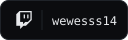
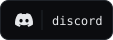
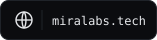
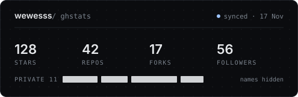
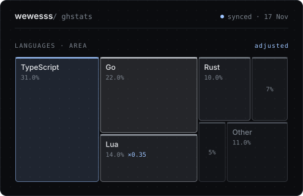
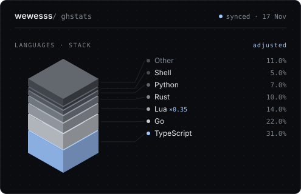
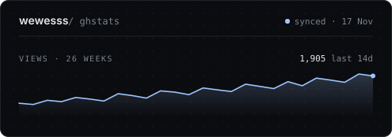

<p align="center"></p>

<h1 align="center">ghstats</h1>

<p align="center">
  <a href="https://github.com/wewesss/ghstats/actions/workflows/ci.yml"></a>
  <a href="https://github.com/wewesss/ghstats/releases"></a>
  <a href="./LICENSE"></a>
  <a href="./go.mod"></a>
</p>

<p align="center">
  <a href="https://www.youtube.com/@wewesss14"><picture><source media="(prefers-color-scheme: dark)" srcset="showcase/project/youtube-dark.svg"><source media="(prefers-color-scheme: light)" srcset="showcase/project/youtube-light.svg"></picture></a>
  <a href="https://www.twitch.tv/wewesss14"><picture><source media="(prefers-color-scheme: dark)" srcset="showcase/project/twitch-dark.svg"><source media="(prefers-color-scheme: light)" srcset="showcase/project/twitch-light.svg"></picture></a>
  <a href="https://discord.com/invite/B6Z5VbA5wd"><picture><source media="(prefers-color-scheme: dark)" srcset="showcase/project/discord-dark.svg"><source media="(prefers-color-scheme: light)" srcset="showcase/project/discord-light.svg"></picture></a>
  <a href="https://miralabs.tech"><picture><source media="(prefers-color-scheme: dark)" srcset="showcase/project/website-dark.svg"><source media="(prefers-color-scheme: light)" srcset="showcase/project/website-light.svg"></picture></a>
  <a href="https://github.com/sponsors/wewesss"><picture><source media="(prefers-color-scheme: dark)" srcset="showcase/project/github_sponsors-dark.svg"><source media="(prefers-color-scheme: light)" srcset="showcase/project/github_sponsors-light.svg"></picture></a>
  <a href="https://opencollective.com/miralabs-tech"><picture><source media="(prefers-color-scheme: dark)" srcset="showcase/project/open_collective-dark.svg"><source media="(prefers-color-scheme: light)" srcset="showcase/project/open_collective-light.svg"></picture></a>
</p>

> "Un moteur de statistiques GitHub qui génère des cartes SVG sombres et claires pour le README de votre profil et conserve l'historique de trafic au-delà de 14 jours."

[English](./README.md) · Français

[Prise en main](./docs/fr/guide/getting-started.md) · [Configuration](./docs/fr/guide/configuration.md) · [Action GitHub](./docs/fr/guide/action.md) · [Cartes](./docs/fr/cards/gallery.md) · [Builder](https://wewesss.github.io/ghstats/) · [Confidentialité](./docs/fr/guide/privacy.md) · [Changelog](./CHANGELOG.md) · [FAQ](./FAQ.fr.md) · [Contribuer](./CONTRIBUTING.fr.md) · [Sécurité](./SECURITY.md)

---

<p align="center">
  <picture>
    <source media="(prefers-color-scheme: dark)" srcset="showcase/identity-dark.svg">
    <source media="(prefers-color-scheme: light)" srcset="showcase/identity-light.svg">
    
  </picture>
</p>

<p align="center">
  <picture>
    <source media="(prefers-color-scheme: dark)" srcset="showcase/wide-dark.svg">
    <source media="(prefers-color-scheme: light)" srcset="showcase/wide-light.svg">
    
  </picture>
</p>

## Qu'est-ce que ghstats ?

ghstats collecte vos dépôts, langages, releases et statistiques de trafic via l'API GitHub, calcule un rapport, puis génère `stats.json` et des cartes SVG sombres et claires. L'historique de trafic (vues et clones) est accumulé au-delà des 14 jours que GitHub conserve.

Il est fourni sous forme d'Action GitHub composite et de CLI. Un workflow planifié met à jour les cartes dans le dépôt de votre profil, et les données brutes, qui contiennent les noms de vos dépôts privés, restent dans un dépôt privé. Aucun nom de dépôt privé n'apparaît dans les fichiers générés.

## Démarrage rapide

Le plus rapide est `ghstats init` : avec la CLI GitHub (`gh`) connectée, il crée les dépôts, le workflow, la configuration, le bloc du README et le secret à votre place (voir [Installation rapide](./docs/fr/guide/getting-started.md#installation-rapide-avec-ghstats-init)). Pour tout faire à la main :

1. Créez un dépôt privé `<user>/ghstats-data`, et un token fine-grained sur votre compte avec Metadata, Contents et Administration en lecture seule sur tous les dépôts, plus Contents en lecture et écriture sur `<user>/ghstats-data`. Enregistrez-le comme secret `GHSTATS_TOKEN` du dépôt de votre profil.
2. Ajoutez ce workflow à votre dépôt `<user>/<user>`, puis lancez-le une fois depuis l'onglet Actions :

```yaml
name: ghstats

on:
  schedule:
    - cron: "17 3 * * *"
  workflow_dispatch:

permissions:
  contents: write

jobs:
  stats:
    runs-on: ubuntu-latest
    steps:
      - uses: actions/checkout@v7

      - uses: actions/checkout@v7
        with:
          repository: <user>/ghstats-data
          path: ghstats-data
          token: ${{ secrets.GHSTATS_TOKEN }}

      - uses: wewesss/ghstats@v1
        with:
          token: ${{ secrets.GHSTATS_TOKEN }}

      - name: Commit the data repository
        working-directory: ghstats-data
        run: |
          git config user.name "github-actions[bot]"
          git config user.email "41898282+github-actions[bot]@users.noreply.github.com"
          git add -A
          if ! git diff --cached --quiet; then
            git commit -m "chore: update ghstats data"
            git push
          fi

      - name: Commit the cards
        run: |
          git config user.name "github-actions[bot]"
          git config user.email "41898282+github-actions[bot]@users.noreply.github.com"
          git add ghstats
          if ! git diff --cached --quiet; then
            git commit -m "chore: update ghstats cards"
            git push
          fi
```

3. Collez ceci dans le README de votre profil :

```html
<picture>
  <source media="(prefers-color-scheme: dark)" srcset="ghstats/stats-dark.svg">
  <source media="(prefers-color-scheme: light)" srcset="ghstats/stats-light.svg">
  
</picture>
```

Le pas-à-pas complet est dans [Prise en main](./docs/fr/guide/getting-started.md).

## Cartes

Trois blocs, chacun avec plusieurs variantes : `stats`, `languages` et `history`. Lister plusieurs variantes les fait alterner sur place. Sept thèmes, neuf accents et cinq palettes de langages s'appliquent à toutes les cartes.

<table>
  <tr>
    <td>
      <picture>
        <source media="(prefers-color-scheme: dark)" srcset="showcase/stats-totals-dark.svg">
        <source media="(prefers-color-scheme: light)" srcset="showcase/stats-totals-light.svg">
        
      </picture>
    </td>
    <td>
      <picture>
        <source media="(prefers-color-scheme: dark)" srcset="showcase/languages-treemap-dark.svg">
        <source media="(prefers-color-scheme: light)" srcset="showcase/languages-treemap-light.svg">
        
      </picture>
    </td>
  </tr>
  <tr>
    <td>
      <picture>
        <source media="(prefers-color-scheme: dark)" srcset="showcase/languages-iso-dark.svg">
        <source media="(prefers-color-scheme: light)" srcset="showcase/languages-iso-light.svg">
        
      </picture>
    </td>
    <td>
      <picture>
        <source media="(prefers-color-scheme: dark)" srcset="showcase/history-views-dark.svg">
        <source media="(prefers-color-scheme: light)" srcset="showcase/history-views-light.svg">
        
      </picture>
    </td>
  </tr>
</table>

Toutes les variantes, avec la configuration qui les produit, sont dans la [galerie](./docs/fr/cards/gallery.md). La carte identité et les badges de liens sont décrits dans [Cartes de profil](./docs/fr/cards/profile.md).

## Stabilité

À partir de la v1.0.0, la configuration `version: 1` et le `schema_version: 1` de `stats.json` et les points d'entrée Go listés dans le [guide pour faire son propre front](./docs/fr/guide/extend.md) sont stables pour toute la série v1 : un champ ajouté ne casse rien, et un changement incompatible sort en v2. Épinglez l'Action avec `wewesss/ghstats@v1`, qui suit la dernière version v1.x.y et installe le binaire correspondant.

L'ancienne version (`github-stats-api-go`, GPL-3.0) est conservée au tag [`legacy-v1.0.0`](https://github.com/wewesss/ghstats/tree/legacy-v1.0.0).

## Sponsor

- GitHub Sponsors : [github.com/sponsors/wewesss](https://github.com/sponsors/wewesss)
- Open Collective : [opencollective.com/miralabs-tech](https://opencollective.com/miralabs-tech)

## Licence

[MIT](LICENSE)
