# ghstats

GitHub statistics engine in Go. It collects your repositories, languages, releases and traffic, keeps the traffic history beyond GitHub's 14 days, and renders a JSON report plus dark and light SVG cards for a profile README.

<picture>
  <source media="(prefers-color-scheme: dark)" srcset="render/testdata/full-dark.svg">
  <source media="(prefers-color-scheme: light)" srcset="render/testdata/full-light.svg">
  
</picture>

## Features

- Blocks `stats`, `languages` and `history`, each with several variants; listing several variants makes them rotate in place.
- Seven theme presets and nine accents, including `cycle`, or fully custom colors.
- Language palettes: `accent`, `github`, `mono`, `spectrum`, `duotone`, or your own map.
- Raw and adjusted language shares: per-language weights, per-repository weights, `exclude`, `hide`, and `hidden_share` (`other` or `renormalize`).
- Traffic history (views and clones) accumulated beyond the 14 days GitHub keeps.
- Privacy: no private repository name appears in any output.
- Reduced-motion support, and `motion: false` to turn every animation off.

## Token

Use a fine-grained personal access token:

- Resource owner: your account, with access to all repositories.
- Repository permissions, read-only: Metadata, Contents, Administration (needed for traffic).

A fine-grained token covers a single owner, so organization repositories get no traffic data. Use one token per organization, or a classic token with the `repo` scope.

`ghstats collect` reads `GHSTATS_TOKEN`, then `GITHUB_TOKEN`.

## CLI

Install with Go or download a release archive from the [releases page](https://github.com/wewesss/ghstats/releases):

```sh
go install github.com/wewesss/ghstats/cmd/ghstats@latest
```

```sh
ghstats collect [--out data/snapshots] [--history data/history.json] [--no-traffic] [--concurrency N]
ghstats compute --snapshot <file> --history <file> --out <report.json> [--config <file>]
ghstats render  --report <report.json> --out-dir <dir> [--config <file>]
ghstats version
```

- `collect` writes `snapshot-<timestamp>.json` into `--out`, merges it into the history file and prints the snapshot path.
- `compute` turns a snapshot and a history into `report.json`.
- `render` writes `stats.json`, `stats-dark.svg` and `stats-light.svg` into `--out-dir`, plus the profile files described under [Profile cards](#profile-cards) when the configuration asks for them, and `README.snippet.md`.

Exit codes: `0` success, `1` runtime error, `2` usage error.

## Configuration

Every key except `version` is optional. See [`config/example.yaml`](config/example.yaml) for the complete file. The `render` keys:

| Key | Allowed values |
| --- | --- |
| `render.blocks` | list of `block: [variants]`: `stats`: `totals`, `distribution`; `languages`: `bars`, `iso`, `cells`, `treemap`, `shift`, `terminal`; `history`: `views`, `clones` |
| `render.private_bar` | `true` or `false` |
| `render.languages.colors` | `accent`, `github`, `mono`, `spectrum`, `duotone`, or a map of language to `"#rrggbb"` |
| `render.theme.preset` | `noir`, `carbon`, `graphite`, `midnight`, `slate`, `dune`, `transparent` |
| `render.theme.accent` | `ice`, `mint`, `amber`, `silver`, `violet`, `rose`, `lime`, `coral`, `cycle`, or `{dark: "#rrggbb", light: "#rrggbb"}` |
| `render.theme.overrides` | keys `bg`, `border`, `fg`, `muted`, `faint` as `"#rrggbb"` (`bg` also accepts `none`) |
| `render.motion` | `true` or `false` |
| `render.layout` | `card` (495 px, default) or `wide` (1000 px, `languages` in a right column, the other blocks stacked on the left) |
| `render.base_path` | prefix of every path written in `README.snippet.md`, ending with `/` (default `ghstats/`) |

## Profile cards

An optional `profile` section adds an identity card and one small badge per link. Everything follows the `render.theme`, so presets, accents (including `cycle`, kept in sync across all cards) and overrides apply to every file.

```yaml
profile:
  name: octocat                    # default: the report login
  tagline: SOFTWARE · GAMES · EXPERIMENTS
  location: caen, fr               # optional
  note: no fixed stack, it depends on what I'm making   # optional
  focus:                           # 1 to 6 entries, each with 1 to 4 building words
    - name: WEB & DESKTOP
      building: [full-stack apps, desktop software]
    - name: GAMES
      building: [gameplay systems, game engines]
  links:                           # kept in this order; an empty value is skipped
    - youtube: "@octocat"          # a handle or a full https:// URL
    - website: https://example.com
    - discord: {url: "https://discord.com/invite/xyz", label: discord}
    - github_sponsors: octocat
render:
  layout: wide
  base_path: ghstats/
```

Link kinds: `youtube`, `twitch`, `kick`, `discord`, `tiktok`, `instagram`, `x`, `bluesky`, `threads`, `mastodon`, `reddit`, `linkedin`, `steam`, `itchio`, `website`, `github_sponsors`, `open_collective`, `buy_me_a_coffee`, `ko_fi`, `patreon`. A value is a handle (a leading `@` is optional) or a full `https://` URL; `mastodon`, `steam` and `website` need a full URL. The map form `{url, label}` overrides the label.

`ghstats render` writes, next to the stats files:

- `identity-dark.svg` and `identity-light.svg`, when `profile` has at least `focus` or `tagline`. The `building` words rotate every 3 seconds and the matching focus row lights up; with `motion: false` or reduced motion the first word and first row are shown.
- `links/<kind>-dark.svg` and `links/<kind>-light.svg` for each non-empty link. ghstats does not delete the files of a link you remove from the configuration.
- `README.snippet.md`: the identity `<picture>` (when generated), the stats `<picture>`, then a centered row with one `<a href="URL"><picture>…</picture></a>` per link, in configuration order. Every path is prefixed with `render.base_path`. Paste it into your profile README.

A link is clickable only when its badge is a separate image wrapped in its own `<a>`, which is why each link is its own SVG file and not part of the identity card. Commit the whole output directory (`git add ghstats`) so the badges and the identity card are published with the stats cards.

The badge icons come from [Simple Icons](https://simpleicons.org) (CC0 1.0). The brand logos remain the property of their respective owners.

## GitHub Action

The repository is a composite Action for Linux and macOS runners. Inputs: `token` (required), `version` (default `latest`), `config` (default `ghstats.yaml`, ignored when the file is missing), `data-dir` (default `ghstats-data`), `output-dir` (default `ghstats`), `traffic` (default `true`). Outputs: `snapshot` and `report`.

Example workflow for a `<user>/<user>` profile repository, with a private `<user>/ghstats-data` repository holding the snapshots and history:

```yaml
name: ghstats

on:
  schedule:
    - cron: "17 3 * * *"
  workflow_dispatch:

permissions:
  contents: write

jobs:
  stats:
    runs-on: ubuntu-latest
    steps:
      - uses: actions/checkout@v7

      - uses: actions/checkout@v7
        with:
          repository: <user>/ghstats-data
          path: ghstats-data
          token: ${{ secrets.GHSTATS_TOKEN }}

      - uses: wewesss/ghstats@v0
        with:
          token: ${{ secrets.GHSTATS_TOKEN }}

      - name: Commit the data repository
        working-directory: ghstats-data
        run: |
          git config user.name "github-actions[bot]"
          git config user.email "41898282+github-actions[bot]@users.noreply.github.com"
          git add -A
          if ! git diff --cached --quiet; then
            git commit -m "chore: update ghstats data"
            git push
          fi

      - name: Commit the cards
        run: |
          git config user.name "github-actions[bot]"
          git config user.email "41898282+github-actions[bot]@users.noreply.github.com"
          git add ghstats
          if ! git diff --cached --quiet; then
            git commit -m "chore: update ghstats cards"
            git push
          fi
```

`GHSTATS_TOKEN` needs Contents read and write on `<user>/ghstats-data`, on top of the permissions listed under Token.

Then reference the committed cards in your profile README:

```html
<picture>
  <source media="(prefers-color-scheme: dark)" srcset="ghstats/stats-dark.svg">
  <source media="(prefers-color-scheme: light)" srcset="ghstats/stats-light.svg">
  
</picture>
```

## Privacy

Raw snapshots contain private repository names. Keep them, and the history file, in a private repository only. The rendered `stats.json` and SVG files never contain a private repository name.

The previous version (`github-stats-api-go`, GPL-3.0) is kept at the [`legacy-v1.0.0`](https://github.com/wewesss/ghstats/tree/legacy-v1.0.0) tag.

## License

[MIT](LICENSE)
