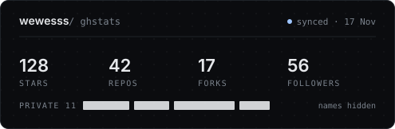
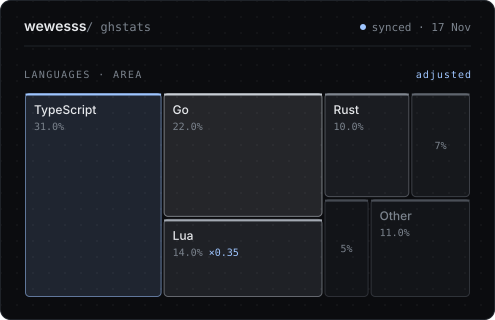

<p align="center"></p>

<h1 align="center">ghstats</h1>

<p align="center">
  <a href="https://github.com/wewesss/ghstats/actions/workflows/ci.yml"></a>
  <a href="https://github.com/wewesss/ghstats/releases"></a>
  <a href="./LICENSE"></a>
  <a href="./go.mod"></a>
</p>

> "A GitHub statistics engine that renders dark and light SVG cards for your profile README and keeps your traffic history beyond 14 days."

English · [Français](./README.fr.md)

[Getting started](./docs/en/guide/getting-started.md) · [Configuration](./docs/en/guide/configuration.md) · [GitHub Action](./docs/en/guide/action.md) · [Cards](./docs/en/cards/gallery.md) · [Builder](https://wewesss.github.io/ghstats/) · [Privacy](./docs/en/guide/privacy.md) · [Changelog](./CHANGELOG.md) · [FAQ](./FAQ.md) · [Contributing](./CONTRIBUTING.md) · [Security](./SECURITY.md)

---

<p align="center">
  <picture>
    <source media="(prefers-color-scheme: dark)" srcset="showcase/identity-dark.svg">
    <source media="(prefers-color-scheme: light)" srcset="showcase/identity-light.svg">
    
  </picture>
</p>

<p align="center">
  <picture>
    <source media="(prefers-color-scheme: dark)" srcset="showcase/wide-dark.svg">
    <source media="(prefers-color-scheme: light)" srcset="showcase/wide-light.svg">
    
  </picture>
</p>

## What is ghstats?

ghstats collects your repositories, languages, releases and traffic through the GitHub API, computes a report, and renders `stats.json` plus dark and light SVG cards. The traffic history (views and clones) is accumulated beyond the 14 days GitHub keeps.

It ships as a composite GitHub Action and as a CLI. A scheduled workflow refreshes the cards in your profile repository, and the raw data, which contains private repository names, stays in a private repository. No private repository name appears in any output.

## Quick start

1. Create a private `<user>/ghstats-data` repository, and a fine-grained token on your account with read-only Metadata, Contents and Administration on all repositories, plus Contents read and write on `<user>/ghstats-data`. Store it as the `GHSTATS_TOKEN` secret of your profile repository.
2. Add this workflow to your `<user>/<user>` repository, then run it once from the Actions tab:

```yaml
name: ghstats

on:
  schedule:
    - cron: "17 3 * * *"
  workflow_dispatch:

permissions:
  contents: write

jobs:
  stats:
    runs-on: ubuntu-latest
    steps:
      - uses: actions/checkout@v7

      - uses: actions/checkout@v7
        with:
          repository: <user>/ghstats-data
          path: ghstats-data
          token: ${{ secrets.GHSTATS_TOKEN }}

      - uses: wewesss/ghstats@v1
        with:
          token: ${{ secrets.GHSTATS_TOKEN }}

      - name: Commit the data repository
        working-directory: ghstats-data
        run: |
          git config user.name "github-actions[bot]"
          git config user.email "41898282+github-actions[bot]@users.noreply.github.com"
          git add -A
          if ! git diff --cached --quiet; then
            git commit -m "chore: update ghstats data"
            git push
          fi

      - name: Commit the cards
        run: |
          git config user.name "github-actions[bot]"
          git config user.email "41898282+github-actions[bot]@users.noreply.github.com"
          git add ghstats
          if ! git diff --cached --quiet; then
            git commit -m "chore: update ghstats cards"
            git push
          fi
```

3. Paste this in your profile README:

```html
<picture>
  <source media="(prefers-color-scheme: dark)" srcset="ghstats/stats-dark.svg">
  <source media="(prefers-color-scheme: light)" srcset="ghstats/stats-light.svg">
  
</picture>
```

The full walkthrough is in [Getting started](./docs/en/guide/getting-started.md).

## Cards

Three blocks, each with several variants: `stats`, `languages` and `history`. Listing several variants makes them rotate in place. Seven theme presets, nine accents and five language palettes apply to every card.

<table>
  <tr>
    <td>
      <picture>
        <source media="(prefers-color-scheme: dark)" srcset="showcase/stats-totals-dark.svg">
        <source media="(prefers-color-scheme: light)" srcset="showcase/stats-totals-light.svg">
        
      </picture>
    </td>
    <td>
      <picture>
        <source media="(prefers-color-scheme: dark)" srcset="showcase/languages-treemap-dark.svg">
        <source media="(prefers-color-scheme: light)" srcset="showcase/languages-treemap-light.svg">
        
      </picture>
    </td>
  </tr>
  <tr>
    <td>
      <picture>
        <source media="(prefers-color-scheme: dark)" srcset="showcase/languages-iso-dark.svg">
        <source media="(prefers-color-scheme: light)" srcset="showcase/languages-iso-light.svg">
        
      </picture>
    </td>
    <td>
      <picture>
        <source media="(prefers-color-scheme: dark)" srcset="showcase/history-views-dark.svg">
        <source media="(prefers-color-scheme: light)" srcset="showcase/history-views-light.svg">
        
      </picture>
    </td>
  </tr>
</table>

Every variant, with the configuration that produces it, is in the [gallery](./docs/en/cards/gallery.md). The identity card and the link badges are described in [Profile cards](./docs/en/cards/profile.md).

## Stability

From v1.0.0 the configuration `version: 1` and the `stats.json` `schema_version: 1` are stable for the whole v1 series: an added field breaks nothing, and an incompatible change ships as v2. Pin the Action with `wewesss/ghstats@v1`, which follows the newest v1.x.y release and installs the matching binary.

The previous version (`github-stats-api-go`, GPL-3.0) is kept at the [`legacy-v1.0.0`](https://github.com/wewesss/ghstats/tree/legacy-v1.0.0) tag.

## Sponsor

- GitHub Sponsors: [github.com/sponsors/wewesss](https://github.com/sponsors/wewesss)
- Open Collective: [opencollective.com/miralabs-tech](https://opencollective.com/miralabs-tech)

## License

[MIT](LICENSE)
