Every image below is generated from a fixed sample report, with `motion: false`, in dark and light. With motion off, the `cycle` accent shows as `ice` and a block that lists several variants shows only the first one, so each image below shows one variant. The two modes follow the viewer's color scheme. Under each image, the `render.blocks` entry that produces it; the other keys are in [Configuration](../guide/configuration.md). With motion on, listing several variants of a block makes them rotate in place.

## Live gallery

Pick a preset, an accent and a palette: every variant below is rendered in your browser, in dark and light.

```demo gallery
```

Open the [live gallery](https://wewesss.github.io/ghstats/en/cards/gallery/) if you are reading this on GitHub: the demo above only runs on the site.

## Static gallery

The images below are the generated files of the `showcase/` folder.

## stats

The `stats` block has two variants.

### stats: totals

<picture>
  <source media="(prefers-color-scheme: dark)" srcset="../../../showcase/stats-totals-dark.svg">
  <source media="(prefers-color-scheme: light)" srcset="../../../showcase/stats-totals-light.svg">
  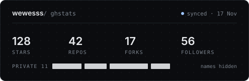
</picture>

```yaml
render:
  blocks:
    - stats: [totals]
```

### stats: distribution

<picture>
  <source media="(prefers-color-scheme: dark)" srcset="../../../showcase/stats-distribution-dark.svg">
  <source media="(prefers-color-scheme: light)" srcset="../../../showcase/stats-distribution-light.svg">
  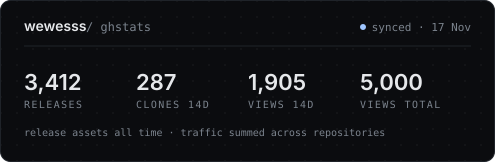
</picture>

```yaml
render:
  blocks:
    - stats: [distribution]
```

## languages

The `languages` block has six variants. The shares follow `languages.mode`.

### languages: bars

<picture>
  <source media="(prefers-color-scheme: dark)" srcset="../../../showcase/languages-bars-dark.svg">
  <source media="(prefers-color-scheme: light)" srcset="../../../showcase/languages-bars-light.svg">
  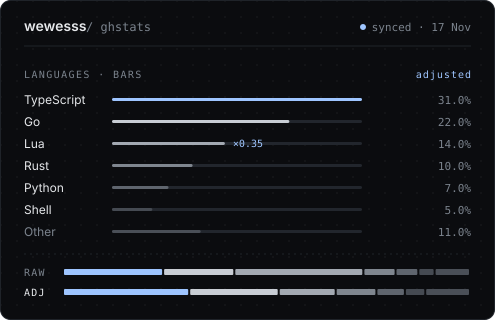
</picture>

```yaml
render:
  blocks:
    - languages: [bars]
```

### languages: iso

<picture>
  <source media="(prefers-color-scheme: dark)" srcset="../../../showcase/languages-iso-dark.svg">
  <source media="(prefers-color-scheme: light)" srcset="../../../showcase/languages-iso-light.svg">
  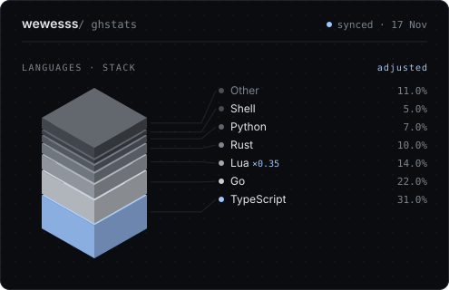
</picture>

```yaml
render:
  blocks:
    - languages: [iso]
```

### languages: cells

<picture>
  <source media="(prefers-color-scheme: dark)" srcset="../../../showcase/languages-cells-dark.svg">
  <source media="(prefers-color-scheme: light)" srcset="../../../showcase/languages-cells-light.svg">
  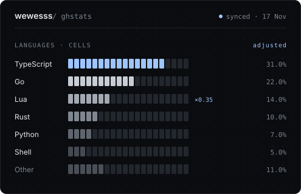
</picture>

```yaml
render:
  blocks:
    - languages: [cells]
```

### languages: treemap

<picture>
  <source media="(prefers-color-scheme: dark)" srcset="../../../showcase/languages-treemap-dark.svg">
  <source media="(prefers-color-scheme: light)" srcset="../../../showcase/languages-treemap-light.svg">
  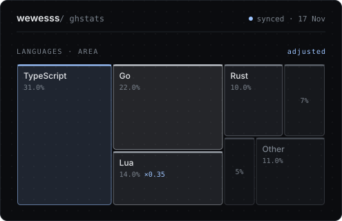
</picture>

```yaml
render:
  blocks:
    - languages: [treemap]
```

### languages: shift

<picture>
  <source media="(prefers-color-scheme: dark)" srcset="../../../showcase/languages-shift-dark.svg">
  <source media="(prefers-color-scheme: light)" srcset="../../../showcase/languages-shift-light.svg">
  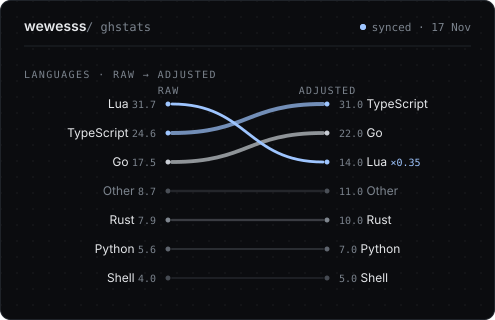
</picture>

```yaml
render:
  blocks:
    - languages: [shift]
```

### languages: terminal

<picture>
  <source media="(prefers-color-scheme: dark)" srcset="../../../showcase/languages-terminal-dark.svg">
  <source media="(prefers-color-scheme: light)" srcset="../../../showcase/languages-terminal-light.svg">
  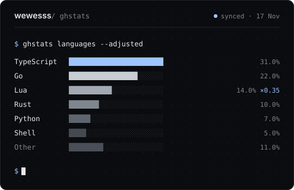
</picture>

```yaml
render:
  blocks:
    - languages: [terminal]
```

## history

The `history` block has two variants, fed by the traffic history.

### history: views

<picture>
  <source media="(prefers-color-scheme: dark)" srcset="../../../showcase/history-views-dark.svg">
  <source media="(prefers-color-scheme: light)" srcset="../../../showcase/history-views-light.svg">
  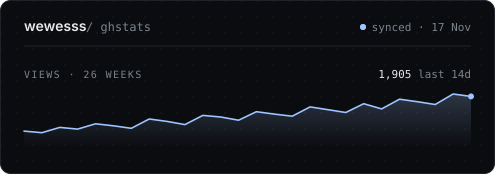
</picture>

```yaml
render:
  blocks:
    - history: [views]
```

### history: clones

<picture>
  <source media="(prefers-color-scheme: dark)" srcset="../../../showcase/history-clones-dark.svg">
  <source media="(prefers-color-scheme: light)" srcset="../../../showcase/history-clones-light.svg">
  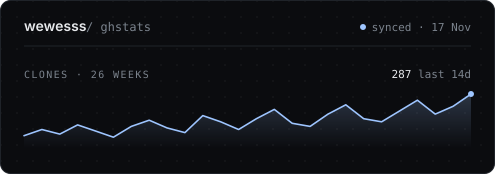
</picture>

```yaml
render:
  blocks:
    - history: [clones]
```

## Wide layout

`render.layout: wide` makes a 1000 px card with `languages` in a right column and the other blocks stacked on the left. This one lists every variant of every block: with motion on they rotate in place, and this image, drawn with motion off, shows the first variant of each block.

<picture>
  <source media="(prefers-color-scheme: dark)" srcset="../../../showcase/wide-dark.svg">
  <source media="(prefers-color-scheme: light)" srcset="../../../showcase/wide-light.svg">
  
</picture>

```yaml
render:
  layout: wide
  blocks:
    - stats: [totals, distribution]
    - languages: [bars, iso, cells, treemap, shift, terminal]
    - history: [views, clones]
```

## Identity card

The identity card comes from the `profile` section. See [Profile cards](./profile.md).

<picture>
  <source media="(prefers-color-scheme: dark)" srcset="../../../showcase/identity-dark.svg">
  <source media="(prefers-color-scheme: light)" srcset="../../../showcase/identity-light.svg">
  
</picture>

```yaml
profile:
  name: wewesss
  tagline: SOFTWARE · GAMES · EXPERIMENTS
  location: caen, fr
  note: no fixed stack — it depends on what I'm making
  focus:
    - name: WEB & DESKTOP
      building: [full-stack apps, desktop software]
    - name: GAMES
      building: [gameplay systems, game engines]
    - name: AI & AUTOMATION
      building: [coding agents, automated workflows]
    - name: SYSTEMS
      building: [runtimes & compilers, native tooling]
  links:
    - youtube: "@wewesss14"
    - website: https://miralabs.tech
    - github_sponsors: wewesss
```

## Link badges

One badge per link of `profile.links`, in configuration order.

<p>
  <picture>
    <source media="(prefers-color-scheme: dark)" srcset="../../../showcase/badges/youtube-dark.svg">
    <source media="(prefers-color-scheme: light)" srcset="../../../showcase/badges/youtube-light.svg">
    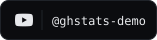
  </picture>
  <picture>
    <source media="(prefers-color-scheme: dark)" srcset="../../../showcase/badges/website-dark.svg">
    <source media="(prefers-color-scheme: light)" srcset="../../../showcase/badges/website-light.svg">
    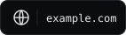
  </picture>
  <picture>
    <source media="(prefers-color-scheme: dark)" srcset="../../../showcase/badges/github_sponsors-dark.svg">
    <source media="(prefers-color-scheme: light)" srcset="../../../showcase/badges/github_sponsors-light.svg">
    
  </picture>
</p>

```yaml
profile:
  links:
    - youtube: "@wewesss14"
    - website: https://miralabs.tech
    - github_sponsors: wewesss
```
