An optional `profile` section adds an identity card and one small badge per link. Everything follows the `render.theme`, so presets, accents (including `cycle`, kept in sync across all cards) and overrides apply to every file.

## Configuration

```yaml
profile:
  name: octocat                    # default: the report login
  tagline: SOFTWARE · GAMES · EXPERIMENTS
  location: caen, fr               # optional
  note: no fixed stack, it depends on what I'm making   # optional
  focus:                           # 1 to 6 entries, each with 1 to 4 building words
    - name: WEB & DESKTOP
      building: [full-stack apps, desktop software]
    - name: GAMES
      building: [gameplay systems, game engines]
  identity:                        # optional
    layout: wide                   # wide (1000 px) or card (495 px, one column)
    show: [header, name, tagline, location, note, building, focus, footer]
  link_style: full                 # full, icon or text
  links:                           # kept in this order; an empty value is skipped
    - youtube: "@octocat"          # a handle or a full https:// URL
    - website: {url: "https://example.com", style: icon}   # style: this link only
    - discord: {url: "https://discord.com/invite/xyz", label: discord}
    - github_sponsors: octocat
    - custom: {url: "https://example.com/blog", label: my blog, icon: youtube}
render:
  layout: wide
  base_path: ghstats/
```

The keys are described in [Configuration](../guide/configuration.md#profile).

## Identity card

<picture>
  <source media="(prefers-color-scheme: dark)" srcset="../../../showcase/identity-dark.svg">
  <source media="(prefers-color-scheme: light)" srcset="../../../showcase/identity-light.svg">
  
</picture>

The identity card is written as `identity-dark.svg` and `identity-light.svg` when `profile` has at least `focus` or `tagline`, when `profile.identity.show` is set, or when `identity` is placed in `render.rows`. The `building` words rotate every 3 seconds and the matching focus row lights up; with `motion: false` or reduced motion the first word and first row are shown.

`profile.identity.show` chooses the parts that are drawn (`header`, `name`, `tagline`, `location`, `note`, `building`, `focus`, `footer`); the height follows the parts that remain, and without `focus` the right column and its rule disappear. `profile.identity.layout: card` draws the card 495 px wide in one column, with the focus list under the text, so it can sit next to a stats card in a row. A card with only a name and a location is valid:

```yaml
profile:
  name: octocat
  location: caen, fr
  identity:
    show: [name, location]
```

The parts and the layout are described in [Configuration](../guide/configuration.md#identity-card).

## Wide layout

<picture>
  <source media="(prefers-color-scheme: dark)" srcset="../../../showcase/wide-dark.svg">
  <source media="(prefers-color-scheme: light)" srcset="../../../showcase/wide-light.svg">
  
</picture>

`render.layout: wide` makes the stats card 1000 px wide, with `languages` in a right column and the other blocks stacked on the left. The identity card has the same width. The default `card` layout is 495 px.

## Link badges

The 21 buttons in the `full` style, with placeholder values.

<p>
  <picture>
    <source media="(prefers-color-scheme: dark)" srcset="../../../showcase/badges/youtube-dark.svg">
    <source media="(prefers-color-scheme: light)" srcset="../../../showcase/badges/youtube-light.svg">
    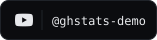
  </picture>
  <picture>
    <source media="(prefers-color-scheme: dark)" srcset="../../../showcase/badges/twitch-dark.svg">
    <source media="(prefers-color-scheme: light)" srcset="../../../showcase/badges/twitch-light.svg">
    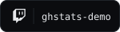
  </picture>
  <picture>
    <source media="(prefers-color-scheme: dark)" srcset="../../../showcase/badges/kick-dark.svg">
    <source media="(prefers-color-scheme: light)" srcset="../../../showcase/badges/kick-light.svg">
    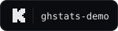
  </picture>
  <picture>
    <source media="(prefers-color-scheme: dark)" srcset="../../../showcase/badges/discord-dark.svg">
    <source media="(prefers-color-scheme: light)" srcset="../../../showcase/badges/discord-light.svg">
    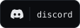
  </picture>
  <picture>
    <source media="(prefers-color-scheme: dark)" srcset="../../../showcase/badges/tiktok-dark.svg">
    <source media="(prefers-color-scheme: light)" srcset="../../../showcase/badges/tiktok-light.svg">
    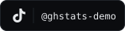
  </picture>
  <picture>
    <source media="(prefers-color-scheme: dark)" srcset="../../../showcase/badges/instagram-dark.svg">
    <source media="(prefers-color-scheme: light)" srcset="../../../showcase/badges/instagram-light.svg">
    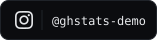
  </picture>
  <picture>
    <source media="(prefers-color-scheme: dark)" srcset="../../../showcase/badges/x-dark.svg">
    <source media="(prefers-color-scheme: light)" srcset="../../../showcase/badges/x-light.svg">
    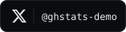
  </picture>
  <picture>
    <source media="(prefers-color-scheme: dark)" srcset="../../../showcase/badges/bluesky-dark.svg">
    <source media="(prefers-color-scheme: light)" srcset="../../../showcase/badges/bluesky-light.svg">
    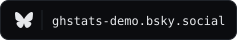
  </picture>
  <picture>
    <source media="(prefers-color-scheme: dark)" srcset="../../../showcase/badges/threads-dark.svg">
    <source media="(prefers-color-scheme: light)" srcset="../../../showcase/badges/threads-light.svg">
    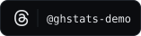
  </picture>
  <picture>
    <source media="(prefers-color-scheme: dark)" srcset="../../../showcase/badges/mastodon-dark.svg">
    <source media="(prefers-color-scheme: light)" srcset="../../../showcase/badges/mastodon-light.svg">
    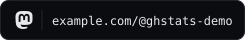
  </picture>
  <picture>
    <source media="(prefers-color-scheme: dark)" srcset="../../../showcase/badges/reddit-dark.svg">
    <source media="(prefers-color-scheme: light)" srcset="../../../showcase/badges/reddit-light.svg">
    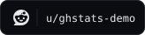
  </picture>
  <picture>
    <source media="(prefers-color-scheme: dark)" srcset="../../../showcase/badges/linkedin-dark.svg">
    <source media="(prefers-color-scheme: light)" srcset="../../../showcase/badges/linkedin-light.svg">
    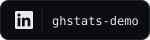
  </picture>
  <picture>
    <source media="(prefers-color-scheme: dark)" srcset="../../../showcase/badges/steam-dark.svg">
    <source media="(prefers-color-scheme: light)" srcset="../../../showcase/badges/steam-light.svg">
    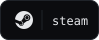
  </picture>
  <picture>
    <source media="(prefers-color-scheme: dark)" srcset="../../../showcase/badges/itchio-dark.svg">
    <source media="(prefers-color-scheme: light)" srcset="../../../showcase/badges/itchio-light.svg">
    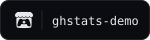
  </picture>
  <picture>
    <source media="(prefers-color-scheme: dark)" srcset="../../../showcase/badges/website-dark.svg">
    <source media="(prefers-color-scheme: light)" srcset="../../../showcase/badges/website-light.svg">
    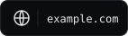
  </picture>
  <picture>
    <source media="(prefers-color-scheme: dark)" srcset="../../../showcase/badges/github_sponsors-dark.svg">
    <source media="(prefers-color-scheme: light)" srcset="../../../showcase/badges/github_sponsors-light.svg">
    
  </picture>
  <picture>
    <source media="(prefers-color-scheme: dark)" srcset="../../../showcase/badges/open_collective-dark.svg">
    <source media="(prefers-color-scheme: light)" srcset="../../../showcase/badges/open_collective-light.svg">
    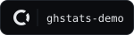
  </picture>
  <picture>
    <source media="(prefers-color-scheme: dark)" srcset="../../../showcase/badges/buy_me_a_coffee-dark.svg">
    <source media="(prefers-color-scheme: light)" srcset="../../../showcase/badges/buy_me_a_coffee-light.svg">
    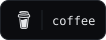
  </picture>
  <picture>
    <source media="(prefers-color-scheme: dark)" srcset="../../../showcase/badges/ko_fi-dark.svg">
    <source media="(prefers-color-scheme: light)" srcset="../../../showcase/badges/ko_fi-light.svg">
    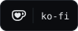
  </picture>
  <picture>
    <source media="(prefers-color-scheme: dark)" srcset="../../../showcase/badges/patreon-dark.svg">
    <source media="(prefers-color-scheme: light)" srcset="../../../showcase/badges/patreon-light.svg">
    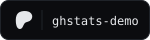
  </picture>
  <picture>
    <source media="(prefers-color-scheme: dark)" srcset="../../../showcase/badges/custom-dark.svg">
    <source media="(prefers-color-scheme: light)" srcset="../../../showcase/badges/custom-light.svg">
    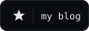
  </picture>
</p>

`links/<kind>-dark.svg` and `links/<kind>-light.svg` are written for each non-empty link. ghstats does not delete the files of a link you remove from the configuration.

Link kinds: `youtube`, `twitch`, `kick`, `discord`, `tiktok`, `instagram`, `x`, `bluesky`, `threads`, `mastodon`, `reddit`, `linkedin`, `steam`, `itchio`, `website`, `github_sponsors`, `open_collective`, `buy_me_a_coffee`, `ko_fi`, `patreon`, `custom` (see [Custom button](#custom-button)). A value is a handle (a leading `@` is optional) or a full `https://` URL; `mastodon`, `steam` and `website` need a full URL. The map form `{url, label, style}` overrides the label and the style.

In `render.rows`, `links/<kind>` places one badge and `links` places the badges that no row places one by one; see [Placing link badges](../guide/configuration.md#placing-link-badges).

A link is clickable only when its badge is a separate image wrapped in its own `<a>`, which is why each link is its own SVG file and not part of the identity card.

The badge icons come from [Simple Icons](https://simpleicons.org) (CC0 1.0). The brand logos remain the property of their respective owners.

## Custom button

The `custom` kind adds a button to any URL. It exists only in the map form, `url` and `label` are required, and it can be listed once.

```yaml
profile:
  links:
    - custom: {url: "https://example.com/blog", label: my blog, icon: youtube}
```

`icon` is optional. Without `icon`, the button shows a globe, like `website`. A known kind name (`youtube`, `discord`...) reuses the embedded icon of that kind. An SVG path starting with `M` or `m` is the `d` attribute of a `<path>` in a 24x24 viewBox, in the [Simple Icons](https://simpleicons.org) format; the characters `<`, `>`, `"` and `&` are rejected.

From left to right: `icon: youtube`, `icon: "M12 2l3 7h7l-5.5 4.5L18.5 21 12 16.8 5.5 21l2-7.5L2 9h7z"`, no `icon`.

<p>
  <picture>
    <source media="(prefers-color-scheme: dark)" srcset="../../../showcase/badges/custom/named-dark.svg">
    <source media="(prefers-color-scheme: light)" srcset="../../../showcase/badges/custom/named-light.svg">
    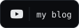
  </picture>
  <picture>
    <source media="(prefers-color-scheme: dark)" srcset="../../../showcase/badges/custom/path-dark.svg">
    <source media="(prefers-color-scheme: light)" srcset="../../../showcase/badges/custom/path-light.svg">
    
  </picture>
  <picture>
    <source media="(prefers-color-scheme: dark)" srcset="../../../showcase/badges/custom/none-dark.svg">
    <source media="(prefers-color-scheme: light)" srcset="../../../showcase/badges/custom/none-light.svg">
    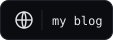
  </picture>
</p>

Validation errors: the scalar form `custom: https://...` is rejected (the message shows the map form), a missing `url` or `label` is rejected, `icon` on a kind other than `custom` is rejected, and an icon that is neither a known kind nor a valid path is rejected.

## Button styles

`profile.link_style` sets the look of every button: `full` (default: icon and label), `icon` (a square with the icon only; the label stays in `aria-label` and `<title>`) or `text` (the label only). Any other value is rejected with the list of the three. The files written and `README.snippet.md` are the same for the three styles.

```yaml
profile:
  link_style: icon
```

A link in the map form can carry its own `style`, which replaces `link_style` for that link: `website: {url: "https://example.com", style: icon}`.

`full`:

<p>
  <picture>
    <source media="(prefers-color-scheme: dark)" srcset="../../../showcase/badges/youtube-dark.svg">
    <source media="(prefers-color-scheme: light)" srcset="../../../showcase/badges/youtube-light.svg">
    
  </picture>
  <picture>
    <source media="(prefers-color-scheme: dark)" srcset="../../../showcase/badges/discord-dark.svg">
    <source media="(prefers-color-scheme: light)" srcset="../../../showcase/badges/discord-light.svg">
    
  </picture>
  <picture>
    <source media="(prefers-color-scheme: dark)" srcset="../../../showcase/badges/github_sponsors-dark.svg">
    <source media="(prefers-color-scheme: light)" srcset="../../../showcase/badges/github_sponsors-light.svg">
    
  </picture>
</p>

`icon`:

<p>
  <picture>
    <source media="(prefers-color-scheme: dark)" srcset="../../../showcase/badges/styles/youtube-icon-dark.svg">
    <source media="(prefers-color-scheme: light)" srcset="../../../showcase/badges/styles/youtube-icon-light.svg">
    
  </picture>
  <picture>
    <source media="(prefers-color-scheme: dark)" srcset="../../../showcase/badges/styles/discord-icon-dark.svg">
    <source media="(prefers-color-scheme: light)" srcset="../../../showcase/badges/styles/discord-icon-light.svg">
    
  </picture>
  <picture>
    <source media="(prefers-color-scheme: dark)" srcset="../../../showcase/badges/styles/github_sponsors-icon-dark.svg">
    <source media="(prefers-color-scheme: light)" srcset="../../../showcase/badges/styles/github_sponsors-icon-light.svg">
    
  </picture>
</p>

`text`:

<p>
  <picture>
    <source media="(prefers-color-scheme: dark)" srcset="../../../showcase/badges/styles/youtube-text-dark.svg">
    <source media="(prefers-color-scheme: light)" srcset="../../../showcase/badges/styles/youtube-text-light.svg">
    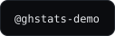
  </picture>
  <picture>
    <source media="(prefers-color-scheme: dark)" srcset="../../../showcase/badges/styles/discord-text-dark.svg">
    <source media="(prefers-color-scheme: light)" srcset="../../../showcase/badges/styles/discord-text-light.svg">
    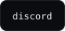
  </picture>
  <picture>
    <source media="(prefers-color-scheme: dark)" srcset="../../../showcase/badges/styles/github_sponsors-text-dark.svg">
    <source media="(prefers-color-scheme: light)" srcset="../../../showcase/badges/styles/github_sponsors-text-light.svg">
    
  </picture>
</p>

## README.snippet.md

`ghstats render` always writes `README.snippet.md` next to the cards: the identity `<picture>` (when generated), the stats `<picture>`, then a centered row with one `<a href="URL"><picture>...</picture></a>` per link, in configuration order. Every path is prefixed with `render.base_path`. Paste it into your profile README.

For the profile of the gallery, the file reads:

```html
<picture>
  <source media="(prefers-color-scheme: dark)" srcset="ghstats/identity-dark.svg">
  <source media="(prefers-color-scheme: light)" srcset="ghstats/identity-light.svg">
  
</picture>

<picture>
  <source media="(prefers-color-scheme: dark)" srcset="ghstats/stats-dark.svg">
  <source media="(prefers-color-scheme: light)" srcset="ghstats/stats-light.svg">
  
</picture>

<p align="center">
<a href="https://www.youtube.com/@wewesss14"><picture><source media="(prefers-color-scheme: dark)" srcset="ghstats/links/youtube-dark.svg"><source media="(prefers-color-scheme: light)" srcset="ghstats/links/youtube-light.svg"></picture></a>
<a href="https://miralabs.tech"><picture><source media="(prefers-color-scheme: dark)" srcset="ghstats/links/website-dark.svg"><source media="(prefers-color-scheme: light)" srcset="ghstats/links/website-light.svg"></picture></a>
<a href="https://github.com/sponsors/wewesss"><picture><source media="(prefers-color-scheme: dark)" srcset="ghstats/links/github_sponsors-dark.svg"><source media="(prefers-color-scheme: light)" srcset="ghstats/links/github_sponsors-light.svg"></picture></a>
</p>
```

Commit the whole output directory (`git add ghstats`) so the badges and the identity card are published with the stats cards. The workflow in [Getting started](../guide/getting-started.md) does it.
