# Galerie

Chaque image ci-dessous est générée à partir d'un rapport d'exemple fixe, avec `motion: false` et l'accent `cycle`, en sombre et en clair. Les deux modes suivent le thème de couleur du visiteur. Sous chaque image, l'entrée `render.blocks` qui la produit ; les autres clés sont dans [Configuration](../guide/configuration.md). Lister plusieurs variantes d'un bloc les fait alterner sur place.

## Galerie vivante

Choisissez un preset, un accent et une palette : chaque variante ci-dessous est rendue dans votre navigateur, en sombre et en clair. L'interface de la démo reste en anglais.

```demo gallery
```

Ouvrez la [galerie en ligne](https://wewesss.github.io/ghstats/fr/cards/gallery/) si vous lisez ceci sur GitHub : la démo ci-dessus ne fonctionne que sur le site.

## Galerie statique

Les images ci-dessous sont les fichiers générés du dossier `showcase/`.

## stats

Le bloc `stats` a deux variantes.

### stats: totals

<picture>
  <source media="(prefers-color-scheme: dark)" srcset="../../../showcase/stats-totals-dark.svg">
  <source media="(prefers-color-scheme: light)" srcset="../../../showcase/stats-totals-light.svg">
  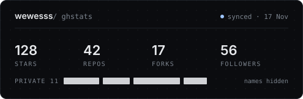
</picture>

```yaml
render:
  blocks:
    - stats: [totals]
```

### stats: distribution

<picture>
  <source media="(prefers-color-scheme: dark)" srcset="../../../showcase/stats-distribution-dark.svg">
  <source media="(prefers-color-scheme: light)" srcset="../../../showcase/stats-distribution-light.svg">
  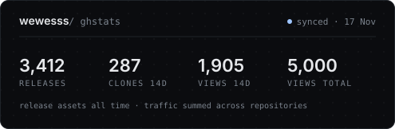
</picture>

```yaml
render:
  blocks:
    - stats: [distribution]
```

## languages

Le bloc `languages` a six variantes. Les parts suivent `languages.mode`.

### languages: bars

<picture>
  <source media="(prefers-color-scheme: dark)" srcset="../../../showcase/languages-bars-dark.svg">
  <source media="(prefers-color-scheme: light)" srcset="../../../showcase/languages-bars-light.svg">
  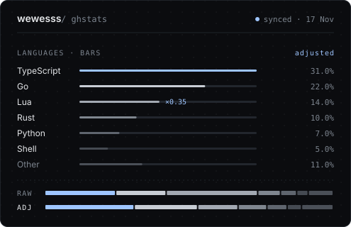
</picture>

```yaml
render:
  blocks:
    - languages: [bars]
```

### languages: iso

<picture>
  <source media="(prefers-color-scheme: dark)" srcset="../../../showcase/languages-iso-dark.svg">
  <source media="(prefers-color-scheme: light)" srcset="../../../showcase/languages-iso-light.svg">
  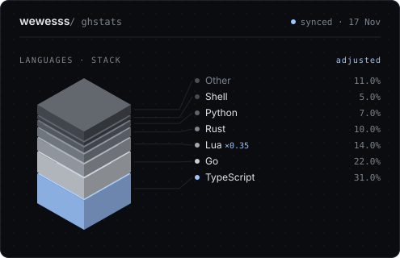
</picture>

```yaml
render:
  blocks:
    - languages: [iso]
```

### languages: cells

<picture>
  <source media="(prefers-color-scheme: dark)" srcset="../../../showcase/languages-cells-dark.svg">
  <source media="(prefers-color-scheme: light)" srcset="../../../showcase/languages-cells-light.svg">
  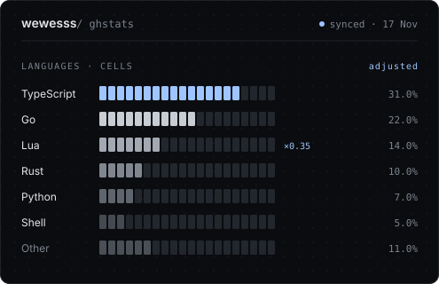
</picture>

```yaml
render:
  blocks:
    - languages: [cells]
```

### languages: treemap

<picture>
  <source media="(prefers-color-scheme: dark)" srcset="../../../showcase/languages-treemap-dark.svg">
  <source media="(prefers-color-scheme: light)" srcset="../../../showcase/languages-treemap-light.svg">
  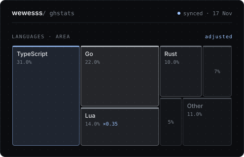
</picture>

```yaml
render:
  blocks:
    - languages: [treemap]
```

### languages: shift

<picture>
  <source media="(prefers-color-scheme: dark)" srcset="../../../showcase/languages-shift-dark.svg">
  <source media="(prefers-color-scheme: light)" srcset="../../../showcase/languages-shift-light.svg">
  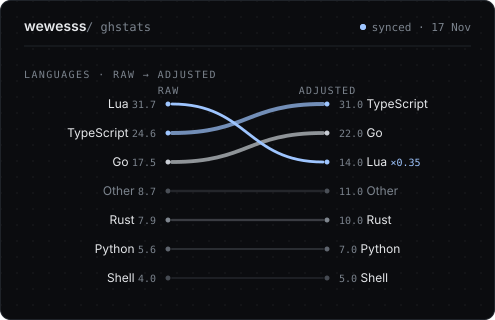
</picture>

```yaml
render:
  blocks:
    - languages: [shift]
```

### languages: terminal

<picture>
  <source media="(prefers-color-scheme: dark)" srcset="../../../showcase/languages-terminal-dark.svg">
  <source media="(prefers-color-scheme: light)" srcset="../../../showcase/languages-terminal-light.svg">
  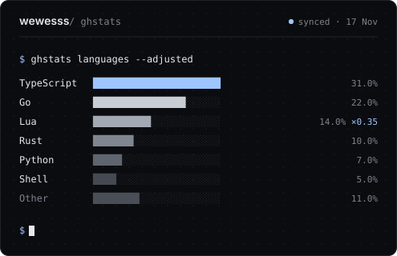
</picture>

```yaml
render:
  blocks:
    - languages: [terminal]
```

## history

Le bloc `history` a deux variantes, alimentées par l'historique de trafic.

### history: views

<picture>
  <source media="(prefers-color-scheme: dark)" srcset="../../../showcase/history-views-dark.svg">
  <source media="(prefers-color-scheme: light)" srcset="../../../showcase/history-views-light.svg">
  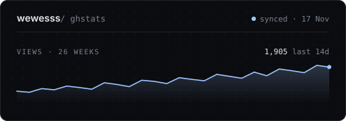
</picture>

```yaml
render:
  blocks:
    - history: [views]
```

### history: clones

<picture>
  <source media="(prefers-color-scheme: dark)" srcset="../../../showcase/history-clones-dark.svg">
  <source media="(prefers-color-scheme: light)" srcset="../../../showcase/history-clones-light.svg">
  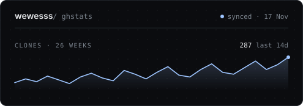
</picture>

```yaml
render:
  blocks:
    - history: [clones]
```

## Disposition large

`render.layout: wide` produit une carte de 1000 px avec `languages` dans une colonne de droite et les autres blocs empilés à gauche. Celle-ci liste toutes les variantes de tous les blocs, qui alternent donc sur place.

<picture>
  <source media="(prefers-color-scheme: dark)" srcset="../../../showcase/wide-dark.svg">
  <source media="(prefers-color-scheme: light)" srcset="../../../showcase/wide-light.svg">
  
</picture>

```yaml
render:
  layout: wide
  blocks:
    - stats: [totals, distribution]
    - languages: [bars, iso, cells, treemap, shift, terminal]
    - history: [views, clones]
```

## Carte identité

La carte identité vient de la section `profile`. Voir [Cartes de profil](./profile.md).

<picture>
  <source media="(prefers-color-scheme: dark)" srcset="../../../showcase/identity-dark.svg">
  <source media="(prefers-color-scheme: light)" srcset="../../../showcase/identity-light.svg">
  
</picture>

```yaml
profile:
  name: wewesss
  tagline: SOFTWARE · GAMES · EXPERIMENTS
  location: caen, fr
  note: no fixed stack — it depends on what I'm making
  focus:
    - name: WEB & DESKTOP
      building: [full-stack apps, desktop software]
    - name: GAMES
      building: [gameplay systems, game engines]
    - name: AI & AUTOMATION
      building: [coding agents, automated workflows]
    - name: SYSTEMS
      building: [runtimes & compilers, native tooling]
  links:
    - youtube: "@wewesss14"
    - website: https://miralabs.tech
    - github_sponsors: wewesss
```

## Badges de liens

Un badge par lien de `profile.links`, dans l'ordre de la configuration.

<p>
  <picture>
    <source media="(prefers-color-scheme: dark)" srcset="../../../showcase/badges/youtube-dark.svg">
    <source media="(prefers-color-scheme: light)" srcset="../../../showcase/badges/youtube-light.svg">
    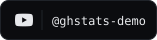
  </picture>
  <picture>
    <source media="(prefers-color-scheme: dark)" srcset="../../../showcase/badges/website-dark.svg">
    <source media="(prefers-color-scheme: light)" srcset="../../../showcase/badges/website-light.svg">
    
  </picture>
  <picture>
    <source media="(prefers-color-scheme: dark)" srcset="../../../showcase/badges/github_sponsors-dark.svg">
    <source media="(prefers-color-scheme: light)" srcset="../../../showcase/badges/github_sponsors-light.svg">
    
  </picture>
</p>

```yaml
profile:
  links:
    - youtube: "@wewesss14"
    - website: https://miralabs.tech
    - github_sponsors: wewesss
```
