Une section `profile` facultative ajoute une carte identité et un petit badge par lien. Tout suit le `render.theme` : les thèmes, les accents (dont `cycle`, synchronisé sur toutes les cartes) et les surcharges s'appliquent à chaque fichier.

## Configuration

```yaml
profile:
  name: octocat                    # par défaut : le login du rapport
  tagline: SOFTWARE · GAMES · EXPERIMENTS
  location: caen, fr               # facultatif
  note: no fixed stack, it depends on what I'm making   # facultatif
  focus:                           # 1 à 6 entrées, chacune avec 1 à 4 mots de building
    - name: WEB & DESKTOP
      building: [full-stack apps, desktop software]
    - name: GAMES
      building: [gameplay systems, game engines]
  identity:                        # facultatif
    layout: wide                   # wide (1000 px) ou card (495 px, une colonne)
    show: [header, name, tagline, location, note, building, focus, footer]
  link_style: full                 # full, icon ou text
  links:                           # gardés dans cet ordre ; une valeur vide est ignorée
    - youtube: "@octocat"          # un identifiant ou une URL https:// complète
    - website: {url: "https://example.com", style: icon}   # style : ce lien seulement
    - discord: {url: "https://discord.com/invite/xyz", label: discord}
    - github_sponsors: octocat
    - custom: {url: "https://example.com/blog", label: my blog, icon: youtube}
render:
  layout: wide
  base_path: ghstats/
```

Les clés sont décrites dans [Configuration](../guide/configuration.md#profile).

## Carte identité

<picture>
  <source media="(prefers-color-scheme: dark)" srcset="../../../showcase/identity-dark.svg">
  <source media="(prefers-color-scheme: light)" srcset="../../../showcase/identity-light.svg">
  
</picture>

La carte identité est écrite sous les noms `identity-dark.svg` et `identity-light.svg` lorsque `profile` contient au moins `focus` ou `tagline`, quand `profile.identity.show` est donné, ou quand `identity` est placé dans `render.rows`. Les mots de `building` alternent toutes les 3 secondes et la ligne de focus correspondante s'allume ; avec `motion: false` ou le mouvement réduit, le premier mot et la première ligne sont affichés.

`profile.identity.show` choisit les parties dessinées (`header`, `name`, `tagline`, `location`, `note`, `building`, `focus`, `footer`) ; la hauteur suit les parties restantes, et sans `focus` la colonne de droite et son trait disparaissent. `profile.identity.layout: card` dessine la carte en 495 px de large sur une colonne, avec la liste du focus sous le texte : elle peut ainsi se placer à côté d'une carte de statistiques dans une ligne. Une carte avec seulement un nom et un lieu est valide :

```yaml
profile:
  name: octocat
  location: caen, fr
  identity:
    show: [name, location]
```

Les parties et la disposition sont décrites dans [Configuration](../guide/configuration.md#carte-identité).

## Disposition large

<picture>
  <source media="(prefers-color-scheme: dark)" srcset="../../../showcase/wide-dark.svg">
  <source media="(prefers-color-scheme: light)" srcset="../../../showcase/wide-light.svg">
  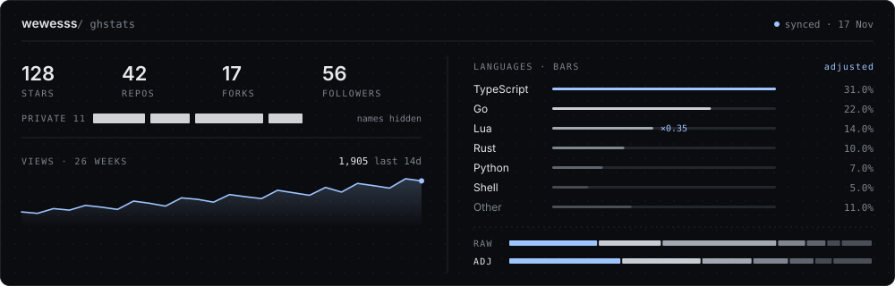
</picture>

`render.layout: wide` donne à la carte de statistiques une largeur de 1000 px, avec `languages` dans une colonne de droite et les autres blocs empilés à gauche. La carte identité ne suit pas `render.layout` : sa largeur vient de `profile.identity.layout`, `wide` (1000 px, le défaut) ou `card` (495 px). La disposition `card` par défaut de `render.layout` fait 495 px.

## Badges de liens

Les 21 boutons, en style `full`, avec des valeurs fictives.

<p>
  <picture>
    <source media="(prefers-color-scheme: dark)" srcset="../../../showcase/badges/youtube-dark.svg">
    <source media="(prefers-color-scheme: light)" srcset="../../../showcase/badges/youtube-light.svg">
    
  </picture>
  <picture>
    <source media="(prefers-color-scheme: dark)" srcset="../../../showcase/badges/twitch-dark.svg">
    <source media="(prefers-color-scheme: light)" srcset="../../../showcase/badges/twitch-light.svg">
    
  </picture>
  <picture>
    <source media="(prefers-color-scheme: dark)" srcset="../../../showcase/badges/kick-dark.svg">
    <source media="(prefers-color-scheme: light)" srcset="../../../showcase/badges/kick-light.svg">
    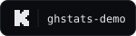
  </picture>
  <picture>
    <source media="(prefers-color-scheme: dark)" srcset="../../../showcase/badges/discord-dark.svg">
    <source media="(prefers-color-scheme: light)" srcset="../../../showcase/badges/discord-light.svg">
    
  </picture>
  <picture>
    <source media="(prefers-color-scheme: dark)" srcset="../../../showcase/badges/tiktok-dark.svg">
    <source media="(prefers-color-scheme: light)" srcset="../../../showcase/badges/tiktok-light.svg">
    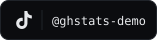
  </picture>
  <picture>
    <source media="(prefers-color-scheme: dark)" srcset="../../../showcase/badges/instagram-dark.svg">
    <source media="(prefers-color-scheme: light)" srcset="../../../showcase/badges/instagram-light.svg">
    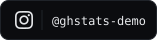
  </picture>
  <picture>
    <source media="(prefers-color-scheme: dark)" srcset="../../../showcase/badges/x-dark.svg">
    <source media="(prefers-color-scheme: light)" srcset="../../../showcase/badges/x-light.svg">
    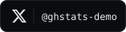
  </picture>
  <picture>
    <source media="(prefers-color-scheme: dark)" srcset="../../../showcase/badges/bluesky-dark.svg">
    <source media="(prefers-color-scheme: light)" srcset="../../../showcase/badges/bluesky-light.svg">
    
  </picture>
  <picture>
    <source media="(prefers-color-scheme: dark)" srcset="../../../showcase/badges/threads-dark.svg">
    <source media="(prefers-color-scheme: light)" srcset="../../../showcase/badges/threads-light.svg">
    
  </picture>
  <picture>
    <source media="(prefers-color-scheme: dark)" srcset="../../../showcase/badges/mastodon-dark.svg">
    <source media="(prefers-color-scheme: light)" srcset="../../../showcase/badges/mastodon-light.svg">
    
  </picture>
  <picture>
    <source media="(prefers-color-scheme: dark)" srcset="../../../showcase/badges/reddit-dark.svg">
    <source media="(prefers-color-scheme: light)" srcset="../../../showcase/badges/reddit-light.svg">
    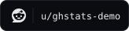
  </picture>
  <picture>
    <source media="(prefers-color-scheme: dark)" srcset="../../../showcase/badges/linkedin-dark.svg">
    <source media="(prefers-color-scheme: light)" srcset="../../../showcase/badges/linkedin-light.svg">
    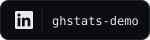
  </picture>
  <picture>
    <source media="(prefers-color-scheme: dark)" srcset="../../../showcase/badges/steam-dark.svg">
    <source media="(prefers-color-scheme: light)" srcset="../../../showcase/badges/steam-light.svg">
    
  </picture>
  <picture>
    <source media="(prefers-color-scheme: dark)" srcset="../../../showcase/badges/itchio-dark.svg">
    <source media="(prefers-color-scheme: light)" srcset="../../../showcase/badges/itchio-light.svg">
    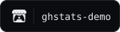
  </picture>
  <picture>
    <source media="(prefers-color-scheme: dark)" srcset="../../../showcase/badges/website-dark.svg">
    <source media="(prefers-color-scheme: light)" srcset="../../../showcase/badges/website-light.svg">
    
  </picture>
  <picture>
    <source media="(prefers-color-scheme: dark)" srcset="../../../showcase/badges/github_sponsors-dark.svg">
    <source media="(prefers-color-scheme: light)" srcset="../../../showcase/badges/github_sponsors-light.svg">
    
  </picture>
  <picture>
    <source media="(prefers-color-scheme: dark)" srcset="../../../showcase/badges/open_collective-dark.svg">
    <source media="(prefers-color-scheme: light)" srcset="../../../showcase/badges/open_collective-light.svg">
    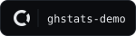
  </picture>
  <picture>
    <source media="(prefers-color-scheme: dark)" srcset="../../../showcase/badges/buy_me_a_coffee-dark.svg">
    <source media="(prefers-color-scheme: light)" srcset="../../../showcase/badges/buy_me_a_coffee-light.svg">
    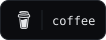
  </picture>
  <picture>
    <source media="(prefers-color-scheme: dark)" srcset="../../../showcase/badges/ko_fi-dark.svg">
    <source media="(prefers-color-scheme: light)" srcset="../../../showcase/badges/ko_fi-light.svg">
    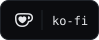
  </picture>
  <picture>
    <source media="(prefers-color-scheme: dark)" srcset="../../../showcase/badges/patreon-dark.svg">
    <source media="(prefers-color-scheme: light)" srcset="../../../showcase/badges/patreon-light.svg">
    
  </picture>
  <picture>
    <source media="(prefers-color-scheme: dark)" srcset="../../../showcase/badges/custom-dark.svg">
    <source media="(prefers-color-scheme: light)" srcset="../../../showcase/badges/custom-light.svg">
    
  </picture>
</p>

`links/<kind>-dark.svg` et `links/<kind>-light.svg` sont écrits pour chaque lien non vide. ghstats ne supprime pas les fichiers d'un lien que vous retirez de la configuration.

Types de liens : `youtube`, `twitch`, `kick`, `discord`, `tiktok`, `instagram`, `x`, `bluesky`, `threads`, `mastodon`, `reddit`, `linkedin`, `steam`, `itchio`, `website`, `github_sponsors`, `open_collective`, `buy_me_a_coffee`, `ko_fi`, `patreon`, `custom` (voir [Bouton personnalisé](#bouton-personnalisé)). Une valeur est un identifiant (le `@` initial est facultatif) ou une URL `https://` complète ; `mastodon`, `steam` et `website` exigent une URL complète. La forme `{url, label, style}` remplace le libellé et le style.

Dans `render.rows`, `links/<kind>` place un badge et `links` place les badges qu'aucune ligne ne place un par un ; voir [Placer les badges de liens](../guide/configuration.md#placer-les-badges-de-liens).

Un lien n'est cliquable que si son badge est une image séparée enveloppée dans son propre `<a>`, ce qui explique pourquoi chaque lien a son propre fichier SVG et ne fait pas partie de la carte identité.

Les icônes des badges viennent de [Simple Icons](https://simpleicons.org) (CC0 1.0). Les logos de marque restent la propriété de leurs détenteurs respectifs.

## Bouton personnalisé

Le type `custom` ajoute un bouton vers n'importe quelle URL. Il n'existe qu'en forme map, `url` et `label` sont obligatoires, et il ne peut être listé qu'une fois.

```yaml
profile:
  links:
    - custom: {url: "https://example.com/blog", label: my blog, icon: youtube}
```

`icon` est facultatif. Sans `icon`, le bouton porte un globe, comme `website`. Un nom de type connu (`youtube`, `discord`...) réutilise l'icône embarquée de ce type. Un tracé SVG commençant par `M` ou `m` est l'attribut `d` d'un `<path>` en viewBox 24x24, au format de [Simple Icons](https://simpleicons.org) ; les caractères `<`, `>`, `"` et `&` sont refusés.

De gauche à droite : `icon: youtube`, `icon: "M12 2l3 7h7l-5.5 4.5L18.5 21 12 16.8 5.5 21l2-7.5L2 9h7z"`, sans `icon`.

<p>
  <picture>
    <source media="(prefers-color-scheme: dark)" srcset="../../../showcase/badges/custom/named-dark.svg">
    <source media="(prefers-color-scheme: light)" srcset="../../../showcase/badges/custom/named-light.svg">
    
  </picture>
  <picture>
    <source media="(prefers-color-scheme: dark)" srcset="../../../showcase/badges/custom/path-dark.svg">
    <source media="(prefers-color-scheme: light)" srcset="../../../showcase/badges/custom/path-light.svg">
    
  </picture>
  <picture>
    <source media="(prefers-color-scheme: dark)" srcset="../../../showcase/badges/custom/none-dark.svg">
    <source media="(prefers-color-scheme: light)" srcset="../../../showcase/badges/custom/none-light.svg">
    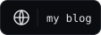
  </picture>
</p>

Erreurs de validation : la forme scalaire `custom: https://...` est refusée (le message montre la forme map), `url` ou `label` manquant est refusé, `icon` sur un autre type que `custom` est refusé, et une icône qui n'est ni un type connu ni un tracé valide est refusée.

## Styles de bouton

`profile.link_style` règle l'apparence de tous les boutons : `full` (par défaut : icône et libellé), `icon` (un carré avec l'icône seule ; le libellé reste dans `aria-label` et `<title>`) ou `text` (le libellé seul). Une autre valeur est refusée avec la liste des trois. Les fichiers écrits et `README.snippet.md` sont les mêmes pour les trois styles.

```yaml
profile:
  link_style: icon
```

Un lien en forme map peut porter son propre `style`, qui remplace `link_style` pour ce lien : `website: {url: "https://example.com", style: icon}`.

`full` :

<p>
  <picture>
    <source media="(prefers-color-scheme: dark)" srcset="../../../showcase/badges/youtube-dark.svg">
    <source media="(prefers-color-scheme: light)" srcset="../../../showcase/badges/youtube-light.svg">
    
  </picture>
  <picture>
    <source media="(prefers-color-scheme: dark)" srcset="../../../showcase/badges/discord-dark.svg">
    <source media="(prefers-color-scheme: light)" srcset="../../../showcase/badges/discord-light.svg">
    
  </picture>
  <picture>
    <source media="(prefers-color-scheme: dark)" srcset="../../../showcase/badges/github_sponsors-dark.svg">
    <source media="(prefers-color-scheme: light)" srcset="../../../showcase/badges/github_sponsors-light.svg">
    
  </picture>
</p>

`icon` :

<p>
  <picture>
    <source media="(prefers-color-scheme: dark)" srcset="../../../showcase/badges/styles/youtube-icon-dark.svg">
    <source media="(prefers-color-scheme: light)" srcset="../../../showcase/badges/styles/youtube-icon-light.svg">
    
  </picture>
  <picture>
    <source media="(prefers-color-scheme: dark)" srcset="../../../showcase/badges/styles/discord-icon-dark.svg">
    <source media="(prefers-color-scheme: light)" srcset="../../../showcase/badges/styles/discord-icon-light.svg">
    
  </picture>
  <picture>
    <source media="(prefers-color-scheme: dark)" srcset="../../../showcase/badges/styles/github_sponsors-icon-dark.svg">
    <source media="(prefers-color-scheme: light)" srcset="../../../showcase/badges/styles/github_sponsors-icon-light.svg">
    
  </picture>
</p>

`text` :

<p>
  <picture>
    <source media="(prefers-color-scheme: dark)" srcset="../../../showcase/badges/styles/youtube-text-dark.svg">
    <source media="(prefers-color-scheme: light)" srcset="../../../showcase/badges/styles/youtube-text-light.svg">
    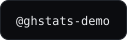
  </picture>
  <picture>
    <source media="(prefers-color-scheme: dark)" srcset="../../../showcase/badges/styles/discord-text-dark.svg">
    <source media="(prefers-color-scheme: light)" srcset="../../../showcase/badges/styles/discord-text-light.svg">
    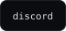
  </picture>
  <picture>
    <source media="(prefers-color-scheme: dark)" srcset="../../../showcase/badges/styles/github_sponsors-text-dark.svg">
    <source media="(prefers-color-scheme: light)" srcset="../../../showcase/badges/styles/github_sponsors-text-light.svg">
    
  </picture>
</p>

## README.snippet.md

`ghstats render` écrit toujours `README.snippet.md` à côté des cartes : le `<picture>` de l'identité (lorsqu'elle est générée), le `<picture>` des statistiques, puis une rangée centrée avec un `<a href="URL"><picture>...</picture></a>` par lien, dans l'ordre de la configuration. Chaque chemin est préfixé par `render.base_path`. Collez-le dans le README de votre profil.

Pour le profil de la galerie, le fichier se lit ainsi :

```html
<picture>
  <source media="(prefers-color-scheme: dark)" srcset="ghstats/identity-dark.svg">
  <source media="(prefers-color-scheme: light)" srcset="ghstats/identity-light.svg">
  
</picture>

<picture>
  <source media="(prefers-color-scheme: dark)" srcset="ghstats/stats-dark.svg">
  <source media="(prefers-color-scheme: light)" srcset="ghstats/stats-light.svg">
  
</picture>

<p align="center">
<a href="https://www.youtube.com/@wewesss14"><picture><source media="(prefers-color-scheme: dark)" srcset="ghstats/links/youtube-dark.svg"><source media="(prefers-color-scheme: light)" srcset="ghstats/links/youtube-light.svg"></picture></a>
<a href="https://miralabs.tech"><picture><source media="(prefers-color-scheme: dark)" srcset="ghstats/links/website-dark.svg"><source media="(prefers-color-scheme: light)" srcset="ghstats/links/website-light.svg"></picture></a>
<a href="https://github.com/sponsors/wewesss"><picture><source media="(prefers-color-scheme: dark)" srcset="ghstats/links/github_sponsors-dark.svg"><source media="(prefers-color-scheme: light)" srcset="ghstats/links/github_sponsors-light.svg"></picture></a>
</p>
```

Commitez tout le dossier de sortie (`git add ghstats`) pour que les badges et la carte identité soient publiés avec les cartes de statistiques. Le workflow de [Prise en main](../guide/getting-started.md) le fait.
