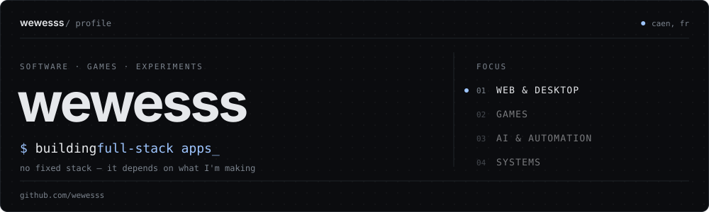
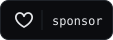

# Cartes de profil

Une section `profile` facultative ajoute une carte identité et un petit badge par lien. Tout suit le `render.theme` : les thèmes, les accents (dont `cycle`, synchronisé sur toutes les cartes) et les surcharges s'appliquent à chaque fichier.

## Configuration

```yaml
profile:
  name: octocat                    # par défaut : le login du rapport
  tagline: SOFTWARE · GAMES · EXPERIMENTS
  location: caen, fr               # facultatif
  note: no fixed stack, it depends on what I'm making   # facultatif
  focus:                           # 1 à 6 entrées, chacune avec 1 à 4 mots de building
    - name: WEB & DESKTOP
      building: [full-stack apps, desktop software]
    - name: GAMES
      building: [gameplay systems, game engines]
  links:                           # gardés dans cet ordre ; une valeur vide est ignorée
    - youtube: "@octocat"          # un identifiant ou une URL https:// complète
    - website: https://example.com
    - discord: {url: "https://discord.com/invite/xyz", label: discord}
    - github_sponsors: octocat
render:
  layout: wide
  base_path: ghstats/
```

Les clés sont décrites dans [Configuration](../guide/configuration.md#profile).

## Carte identité

<picture>
  <source media="(prefers-color-scheme: dark)" srcset="../../../showcase/identity-dark.svg">
  <source media="(prefers-color-scheme: light)" srcset="../../../showcase/identity-light.svg">
  
</picture>

La carte identité est écrite sous les noms `identity-dark.svg` et `identity-light.svg` lorsque `profile` contient au moins `focus` ou `tagline`. Les mots de `building` alternent toutes les 3 secondes et la ligne de focus correspondante s'allume ; avec `motion: false` ou le mouvement réduit, le premier mot et la première ligne sont affichés.

## Disposition large

<picture>
  <source media="(prefers-color-scheme: dark)" srcset="../../../showcase/wide-dark.svg">
  <source media="(prefers-color-scheme: light)" srcset="../../../showcase/wide-light.svg">
  
</picture>

`render.layout: wide` donne à la carte de statistiques une largeur de 1000 px, avec `languages` dans une colonne de droite et les autres blocs empilés à gauche. La carte identité a la même largeur. La disposition `card` par défaut fait 495 px.

## Badges de liens

<p>
  <picture>
    <source media="(prefers-color-scheme: dark)" srcset="../../../showcase/badges/youtube-dark.svg">
    <source media="(prefers-color-scheme: light)" srcset="../../../showcase/badges/youtube-light.svg">
    
  </picture>
  <picture>
    <source media="(prefers-color-scheme: dark)" srcset="../../../showcase/badges/website-dark.svg">
    <source media="(prefers-color-scheme: light)" srcset="../../../showcase/badges/website-light.svg">
    
  </picture>
  <picture>
    <source media="(prefers-color-scheme: dark)" srcset="../../../showcase/badges/github_sponsors-dark.svg">
    <source media="(prefers-color-scheme: light)" srcset="../../../showcase/badges/github_sponsors-light.svg">
    
  </picture>
</p>

`links/<kind>-dark.svg` et `links/<kind>-light.svg` sont écrits pour chaque lien non vide. ghstats ne supprime pas les fichiers d'un lien que vous retirez de la configuration.

Types de liens : `youtube`, `twitch`, `kick`, `discord`, `tiktok`, `instagram`, `x`, `bluesky`, `threads`, `mastodon`, `reddit`, `linkedin`, `steam`, `itchio`, `website`, `github_sponsors`, `open_collective`, `buy_me_a_coffee`, `ko_fi`, `patreon`. Une valeur est un identifiant (le `@` initial est facultatif) ou une URL `https://` complète ; `mastodon`, `steam` et `website` exigent une URL complète. La forme `{url, label}` remplace le libellé.

Un lien n'est cliquable que si son badge est une image séparée enveloppée dans son propre `<a>`, ce qui explique pourquoi chaque lien a son propre fichier SVG et ne fait pas partie de la carte identité.

Les icônes des badges viennent de [Simple Icons](https://simpleicons.org) (CC0 1.0). Les logos de marque restent la propriété de leurs détenteurs respectifs.

## README.snippet.md

`ghstats render` écrit toujours `README.snippet.md` à côté des cartes : le `<picture>` de l'identité (lorsqu'elle est générée), le `<picture>` des statistiques, puis une rangée centrée avec un `<a href="URL"><picture>...</picture></a>` par lien, dans l'ordre de la configuration. Chaque chemin est préfixé par `render.base_path`. Collez-le dans le README de votre profil.

Pour le profil de la galerie, le fichier se lit ainsi :

```html
<picture>
  <source media="(prefers-color-scheme: dark)" srcset="ghstats/identity-dark.svg">
  <source media="(prefers-color-scheme: light)" srcset="ghstats/identity-light.svg">
  
</picture>

<picture>
  <source media="(prefers-color-scheme: dark)" srcset="ghstats/stats-dark.svg">
  <source media="(prefers-color-scheme: light)" srcset="ghstats/stats-light.svg">
  
</picture>

<p align="center">
<a href="https://www.youtube.com/@wewesss14"><picture><source media="(prefers-color-scheme: dark)" srcset="ghstats/links/youtube-dark.svg"><source media="(prefers-color-scheme: light)" srcset="ghstats/links/youtube-light.svg"></picture></a>
<a href="https://miralabs.tech"><picture><source media="(prefers-color-scheme: dark)" srcset="ghstats/links/website-dark.svg"><source media="(prefers-color-scheme: light)" srcset="ghstats/links/website-light.svg"></picture></a>
<a href="https://github.com/sponsors/wewesss"><picture><source media="(prefers-color-scheme: dark)" srcset="ghstats/links/github_sponsors-dark.svg"><source media="(prefers-color-scheme: light)" srcset="ghstats/links/github_sponsors-light.svg"></picture></a>
</p>
```

Commitez tout le dossier de sortie (`git add ghstats`) pour que les badges et la carte identité soient publiés avec les cartes de statistiques. Le workflow de [Prise en main](../guide/getting-started.md) le fait.
